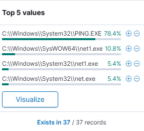
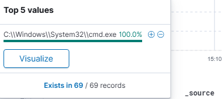
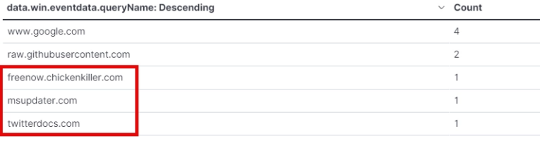
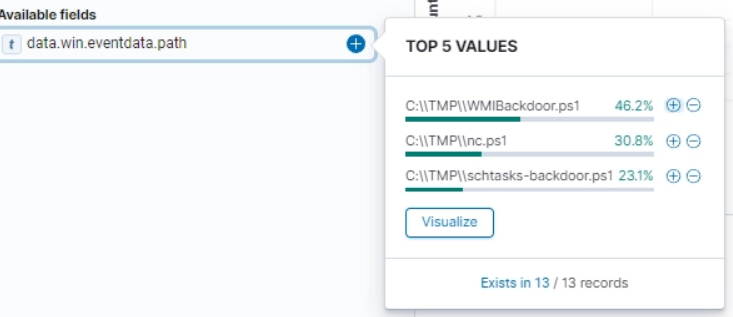
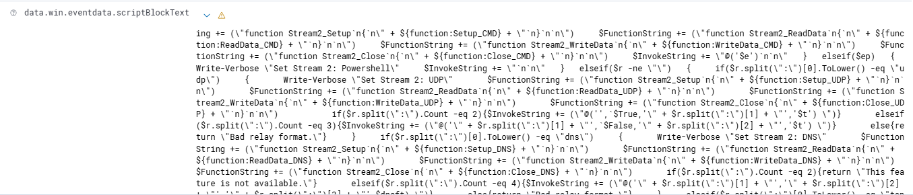
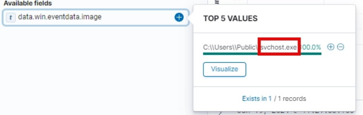
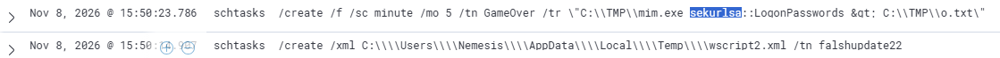
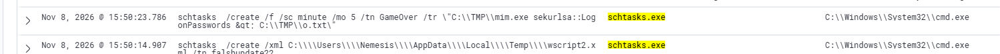

# APT Simülatörü Log Analizi

Bir lab ortamında çalıştırılan APT simülasyonunun Windows/Sysmon loglarını **SIEM üzerinden (Wazuh/Elastic tarzı `data.win.*` alanları)** inceleyen alıştırma çözümü. Amaç; keşif, C2, kalıcılık ve kimlik bilgisi çalma adımlarını loglardan tespit etmek ve saldırı zincirini MITRE ATT&CK ile eşleştirmektir.

> ⚠️ Bu çalışma yalnızca eğitim ve lab amaçlıdır. Gösterilen tüm aktivite kontrollü bir test ortamında üretilmiştir.

## İçindekiler

- [Özet](#özet)
- [Saldırı zinciri](#saldırı-zinciri)
- [Zaman çizelgesi](#zaman-çizelgesi)
- [Bulgular](#bulgular)
- [IOC listesi](#ioc-listesi)
- [MITRE ATT&CK eşleştirmesi](#mitre-attck-eşleştirmesi)
- [Tespit önerileri](#tespit-önerileri)
- [Müdahale ve önleme](#müdahale-ve-önleme)
- [Soru-cevap özeti](#soru-cevap-özeti)
- [Sınırlamalar](#sınırlamalar)

## Özet

Loglarda şu davranış zinciri görüldü:

1. `cmd.exe` üzerinden **ping** ve **net/net1** ile ağ keşfi
2. Şüpheli üç alan adı için **DNS sorguları** (C2 şüphesi)
3. `C:\TMP` altından **PowerShell betikleri** (powercat, WMI ve schtasks backdoor adlı betikler)
4. `C:\Users\Public\svchost.exe` ile **masquerading**
5. **Zamanlanmış görevlerle kalıcılık**
6. Yeniden adlandırılmış **Mimikatz** (`mim.exe`) ile kimlik bilgisi dökümü, çıktı `C:\TMP\o.txt`

Domainler, dosya adları ve görev adları, olasılıkla Nextron'un **APT Simulator** aracının artefaktlarıyla örtüşüyor. Bu loglardan kesin olarak doğrulanamaz, bir çıkarımdır.

## Saldırı zinciri

```
Keşif ──► C2 (DNS) ──► PowerShell betikleri ──► Masquerading ──► Kalıcılık ──► Credential dump
(ping/net)  (3 domain)   (nc.ps1 + 2 backdoor)   (sahte svchost)  (schtasks)    (mim.exe → o.txt)
```

## Zaman çizelgesi

Loglarda doğrudan görünen zaman damgaları:

| Zaman | Olay |
|---|---|
| Nov 8, 2026 @ 15:50:14.907 | `schtasks /create /xml ...wscript2.xml /tn falshupdate22` |
| Nov 8, 2026 @ 15:50:23.786 | `schtasks /create /f /sc minute /mo 5 /tn GameOver ...mim.exe sekurlsa::LogonPasswords` |

İki görev oluşturma arasında yaklaşık **9 saniye** var, bu otomatik bir betik akışına işaret ediyor. Diğer aşamaların zamanı ekran görüntülerinde görünmediği için burada yer almıyor.

## Bulgular

### 1. Remote System Discovery

Sysmon Event ID 1 üzerinde "Remote System Discovery" etiketli süreçler:

| Süreç | Yaklaşık adet | Oran |
|---|---|---|
| `PING.EXE` (System32) | 29 | %78,4 |
| `net1.exe` (SysWOW64) | 4 | %10,8 |
| `net1.exe` (System32) | 2 | %5,4 |
| `net.exe` (System32) | 2 | %5,4 |

Toplam 37 kayıt. Hepsinin parent süreci `cmd.exe`. `net1.exe` normalde `net.exe` tarafından başlatılan alt süreçtir. SysWOW64 sürümünün görünmesi 32-bit bir çağrıya işaret edebilir.




Sorgu:
```
data.win.system.eventID:1 AND "Remote System Discovery"
```

### 2. DNS sorguları (Sysmon Event ID 22)

Meşru olanlar (`www.google.com`, `raw.githubusercontent.com`) dışında üç şüpheli alan adı:

| Alan adı | Sorgu sayısı |
|---|---|
| `freenow.chickenkiller.com` | 1 |
| `msupdater.com` | 1 |
| `twitterdocs.com` | 1 |

`msupdater` ve `twitterdocs`, meşru bir servis gibi görünmeye çalışan isimler. `chickenkiller.com` ise ücretsiz dinamik DNS hizmeti sunan bir alan adı, bu tür altyapı saldırganlar tarafından sık kullanılır.

VirusTotal'da üçü de zararlı olarak raporlanmış:
- [freenow.chickenkiller.com](https://www.virustotal.com/gui/domain/freenow.chickenkiller.com)
- [msupdater.com](https://www.virustotal.com/gui/domain/msupdater.com)
- [twitterdocs.com](https://www.virustotal.com/gui/domain/twitterdocs.com)



Sorgu:
```
data.win.system.eventID:22
```

### 3. TMP altından PowerShell betikleri (Event ID 4104)

13 script block kaydı, üç betik:

| Betik | Kayıt | Oran |
|---|---|---|
| `C:\TMP\WMIBackdoor.ps1` | 6 | %46,2 |
| `C:\TMP\nc.ps1` | 4 | %30,8 |
| `C:\TMP\schtasks-backdoor.ps1` | 3 | %23,1 |

Alfabetik (büyük/küçük harf duyarsız) ilk betik: **`nc.ps1`**.

`nc.ps1` içinde **powercat** fonksiyonu tanımlı. Powercat, netcat benzeri bir PowerShell aracıdır. Script block içinde TCP, UDP ve DNS üzerinden relay kodu görülüyor. Saldırgana hedef sistemde **reverse shell** imkânı sağlar.

`WMIBackdoor.ps1` ve `schtasks-backdoor.ps1` betiklerinin içeriği bu çalışmada incelenmedi. Aşağıdaki yorum yalnızca dosya adlarına dayanıyor: WMI ve zamanlanmış görev tabanlı kalıcılık.




Sorgu:
```
data.win.system.eventID:4104 AND data.win.eventdata.path:*TMP*
```

### 4. Masquerading

Meşru `svchost.exe` yalnızca `C:\Windows\System32` (ve 32-bit için SysWOW64) altından çalışır. Burada süreç şu konumdan çalışmış:

```
C:\Users\Public\svchost.exe
```

Bu, ad taklidi ve konum uyuşmazlığı. Kullanıcı tarafından yazılabilen bir klasörden çalışan `svchost.exe` güçlü bir tespit sinyalidir.



Sorgu:
```
data.win.system.eventID:1 AND "Masquerading"
```

### 5. Zamanlanmış görevler ve Mimikatz

İki `schtasks.exe` çağrısı, ikisinin de parent'ı `cmd.exe`:

**a) Credential dump görevi**
```
schtasks /create /f /sc minute /mo 5 /tn GameOver /tr "C:\TMP\mim.exe sekurlsa::LogonPasswords > C:\TMP\o.txt"
```
- `mim.exe`, yeniden adlandırılmış **Mimikatz**
- `sekurlsa::LogonPasswords`: bellekten (LSASS) oturum açma kimlik bilgilerini döker
- Çıktı: `C:\TMP\o.txt`
- Her **5 dakikada bir** çalışır (`/sc minute /mo 5`), `/f` ile varsa üzerine yazılır
- Görev adı (`GameOver`) olayın ciddiyetini ima eden dikkat çekici bir isim

**b) İkinci görev**
```
schtasks /create /xml C:\Users\Nemesis\AppData\Local\Temp\wscript2.xml /tn falshupdate22
```
- Görev tanımı bir XML dosyasından geliyor (`wscript2.xml`), içeriği bu çalışmada incelenmedi
- Görev adı bir Flash güncellemesini taklit ediyor (`falshupdate22`)





> Not: Ekran görüntülerinde `&gt;` görünmesi HTML kaçışıdır, gerçek komutta `>` yönlendirmesidir.

## IOC listesi

**Alan adları**

| IOC | Tür |
|---|---|
| `freenow.chickenkiller.com` | C2 şüphesi (DNS) |
| `msupdater.com` | C2 şüphesi (DNS) |
| `twitterdocs.com` | C2 şüphesi (DNS) |

**Dosyalar**

| Yol | Açıklama |
|---|---|
| `C:\TMP\nc.ps1` | powercat |
| `C:\TMP\WMIBackdoor.ps1` | backdoor betiği (ad bazlı) |
| `C:\TMP\schtasks-backdoor.ps1` | backdoor betiği (ad bazlı) |
| `C:\TMP\mim.exe` | yeniden adlandırılmış Mimikatz |
| `C:\TMP\o.txt` | Mimikatz çıktısı (düz metin kimlik bilgileri içerebilir) |
| `C:\Users\Public\svchost.exe` | sahte svchost |
| `C:\Users\Nemesis\AppData\Local\Temp\wscript2.xml` | görev tanım dosyası |

**Zamanlanmış görevler**

| Ad | Not |
|---|---|
| `GameOver` | 5 dakikada bir Mimikatz |
| `falshupdate22` | XML tabanlı, Flash güncellemesi taklidi |

## MITRE ATT&CK eşleştirmesi

| Taktik | Teknik | Kanıt |
|---|---|---|
| Discovery | [T1018 Remote System Discovery](https://attack.mitre.org/techniques/T1018/) | ping, net, net1 |
| Command and Control | [T1071.004 Application Layer Protocol: DNS](https://attack.mitre.org/techniques/T1071/004/) | 3 şüpheli domain |
| Execution | [T1059.001 PowerShell](https://attack.mitre.org/techniques/T1059/001/) | `C:\TMP\*.ps1` (Event 4104) |
| Defense Evasion | [T1036.005 Masquerading: Match Legitimate Name or Location](https://attack.mitre.org/techniques/T1036/005/) | `C:\Users\Public\svchost.exe` |
| Persistence | [T1053.005 Scheduled Task](https://attack.mitre.org/techniques/T1053/005/) | `GameOver`, `falshupdate22` |
| Credential Access | [T1003.001 LSASS Memory](https://attack.mitre.org/techniques/T1003/001/) | `mim.exe sekurlsa::LogonPasswords` |

## Tespit önerileri

Aşağıdaki sorgular bu çalışmadaki alan adlarına göre yazılmış örneklerdir, kendi ortamında test et.

- **Kullanıcı dizininden svchost.exe**
  ```
  data.win.system.eventID:1 AND data.win.eventdata.image:*svchost.exe AND NOT data.win.eventdata.image:*System32*
  ```
- **Komut satırında Mimikatz modülleri** (ad değişse bile yakalar)
  ```
  data.win.system.eventID:1 AND data.win.eventdata.commandLine:*sekurlsa*
  ```
- **cmd.exe tarafından oluşturulan sık çalışan zamanlanmış görevler**
  ```
  data.win.system.eventID:1 AND data.win.eventdata.commandLine:*schtasks*create*
  ```
- **LSASS'a erişim:** Sysmon Event ID 10 (ProcessAccess), hedef `lsass.exe`
- **`C:\TMP` ve `C:\Users\Public` altında yürütülebilir/betik dosyası oluşturma:** Sysmon Event ID 11
- **Dinamik DNS ve benzer görünümlü alan adları:** Event ID 22 üzerinde tehdit istihbaratı eşleştirmesi

## Müdahale ve önleme

**Müdahale (gerçek bir olayda)**
1. İlgili zamanlanmış görevleri sil (`GameOver`, `falshupdate22`)
2. `C:\TMP` ve `C:\Users\Public` altındaki dosyaları adli analiz için al, sonra kaldır
3. `o.txt` içeriğini incele, içindeki tüm hesapların parolalarını sıfırla
4. Üç domain'i DNS/proxy seviyesinde engelle
5. WMI event subscription'ları kontrol et (WMI backdoor şüphesi)

**Önleme**
- PowerShell **Script Block Logging** açık tut (bu çalışmada tespiti sağlayan da buydu)
- **LSA koruması** (RunAsPPL) ve **Credential Guard** etkinleştir
- Kullanıcı tarafından yazılabilir dizinlerden yürütmeyi **AppLocker/WDAC** ile kısıtla
- Sysmon yapılandırmasında Event ID 1, 10, 11 ve 22'yi açık tut

## Soru-cevap özeti

| # | Soru | Cevap |
|---|---|---|
| 1 | En çok çalışan Remote System Discovery süreci | `PING.EXE` |
| 2 | Diğer Remote System Discovery süreçleri | `net.exe` (ve `net1.exe`) |
| 3 | İki tekniğin parent image'ı | `cmd.exe` |
| 4 | DNS: alfabetik 1. domain | `freenow.chickenkiller.com` |
| 5 | DNS: alfabetik 2. domain | `msupdater.com` |
| 6 | DNS: alfabetik 3. domain | `twitterdocs.com` |
| 7 | TMP'den ilk .ps1 (alfabetik) | `nc.ps1` |
| 8 | nc.ps1 hangi fonksiyonu tanımlıyor | `powercat` |
| 9 | Netcat benzeri, reverse ____ | `shell` |
| 10 | Masquerading yapan exe | `svchost.exe` |
| 11 | Zamanlanmış görev olarak kurulan parola çalıcı | Mimikatz |
| 12 | Çıktı dosyası | `o.txt` |
| 13 | Her iki görevin parent'ı | `cmd.exe` |

## Sınırlamalar

- Analiz yalnızca ekran görüntülerinde görünen alanlara dayanır, ham loglar repoda yoktur.
- `WMIBackdoor.ps1`, `schtasks-backdoor.ps1` ve `wscript2.xml` içerikleri incelenmemiştir.
- Ekran görüntülerindeki kayıt sayıları farklı sorgulardan geliyor (ör. 37 ve 69 kayıt), tüm sorgular aynı zaman aralığında çalıştırılmamış olabilir.
- Zaman çizelgesi yalnızca loglarda görünen iki olayı kapsar.
